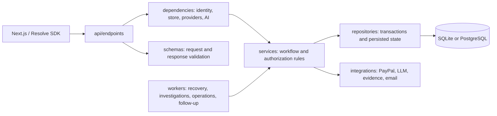

# Backend architecture

Resolve uses a small application factory, HTTP adapters, feature-oriented
services, explicit provider clients, shared contracts and transactional storage.
This is a structural refactor of the existing implementation. It does not add a
new payment flow, provider, model, environment variable or database migration.

## Execution flow



`app.main` exports the same `app` and `create_app`. `app.application.create_app`
selects settings and storage, wires the existing lifespan, installs HTTP policy,
and includes `app.api.router`. Store initialization still occurs during lifespan
startup, not during module import. Shutdown closes the same PayPal and follow-up
HTTP clients and store, in the existing order.

Authentication dependencies resolve the merchant and role before endpoint work.
Services apply the existing ownership and workflow rules and coordinate provider
calls. Pydantic contracts serialize the result back to the unchanged HTTP API.
Background workers call services directly rather than going through HTTP routes.

## Canonical layout

```text
backend/
  app/
    main.py                  ASGI entry point
    application.py           Factory, dependency wiring and resource lifespan
    api/
      router.py              Ordered public route composition
      errors.py              StoreError-to-HTTP translation
      middleware.py          Response security headers and request completion
      security.py            Private authentication validation/error policy
      endpoints/             Existing URLs grouped by API feature
    core/
      config.py              Application settings and backend-relative paths
      investigation_config.py  Process-only investigation settings
      extraction_config.py   Process-only extraction settings
      exceptions.py          Shared domain/storage error
      security.py            Existing password hashing and verification
      validation.py          Pure shared input validation
    dependencies/
      auth.py                Merchant, role and store dependencies
      providers.py           Request-scoped workspace provider selection
      ai.py                  Extraction configuration, client and usage lifetime
    schemas/                 Single definitions of Pydantic contracts/types
    services/
      payments/              Reconciliation, approvals, execution and history
      resolution/            Cases, evidence, commitments, checks and remedies
      commerce/              Connected orders, embedded aftercare and event feed
      merchant/              Identity, keys, connections, imports and operations
      customer/              Portal, messages, intake, account and notification flow
      assurance/             Returns, refund tracing and dispute evidence
      ai/                    Extraction validation and bounded investigation
    integrations/
      paypal/                Sandbox client, PayPal login and evidence adapter
      llm/                   Groq/OpenRouter JSON clients and extraction transport
      evidence/              Existing optional evidence-provider adapters
      email/                 Existing SMTP transport
      support/               Existing helpdesk adapter
    repositories/
      base.py                Shared transactional ResolveStore operations
      sqlite.py              SQLite transactions and immutable migrations
      postgres.py            PostgreSQL adapter, pool and immutable migrations
      factory.py             Configured storage selection
      merchant_queries.py    Merchant-scoped audit/key/connection queries
      commerce_queries.py    Linked-order lookup
      health.py              Sanitized read-only database readiness
    workers/                 Refund recovery, investigation, operations, follow-up
    cli/                     Merchant management and SQLite migration commands
    testing/                 Existing synthetic investigation evaluation support
    _compat.py               Legacy import identity bridge
    *.py                     Thin legacy import/CLI compatibility entry points
  migrations/                Unchanged numbered migrations
  tests/                     Existing regression suite and boundary checks
  scripts/                   Existing isolated checks and contract export
  pyproject.toml, uv.lock     Unchanged application dependencies
```

No ORM/model layer or extra dependency-injection framework was introduced. This
project uses Pydantic schemas and SQL repositories, so a second `models/` package
would duplicate those roles.

## Important module boundaries

The 30 route declarations previously in `main.py` now live in health, case,
payment-evidence, approval and execution endpoint modules. Existing feature
routers retain their URL prefixes, validation, dependencies and response models.
The router keeps static resolution paths before parameterized case-ID paths.

Endpoint SQL moved into query repositories and services. Integration-key
capacity checks, issuance, support grants and audit remain in one transaction.
Buyer order resolution still authorizes the private token inside the same
transaction before reading its order association.

The former merchant `Operations` implementation is split into offers, returns,
monitoring and dispute-package services. Its stable facade delegates to those
services with the same store and resolution workspace. Financial state-machine
methods and transaction boundaries were retained rather than redesigned.

Provider request handling remains real integration code. The extraction
transport receives an already minimized transcript; proposal validation, privacy
rules, budgets and cache decisions remain in the AI service. Existing timeout,
retry, fixed-origin, TLS and model-policy settings are unchanged.

All request/response contracts, including those previously embedded in routes
or services, now have one definition in `schemas/`. Workflows reexport moved
types only for compatibility; they do not define duplicate models. Schemas
depend on other schemas or pure core validation, not on services, HTTP or storage.

## Compatibility and preserved decisions

Old imports such as `app.settings`, `app.storage`, `app.models`, `app.paypal` and
`app.investigations` resolve to the exact canonical module object. This preserves
dependency overrides and monkeypatch namespaces as well as import names. New
code should use canonical paths. CLI wrappers execute the relocated module as
`__main__`, preserving command parsing and machine-readable worker output.

Application settings retain `RESOLVE_` and the same backend `.env` location.
Investigation/extraction settings still use their separate process-only prefixes
and deliberately do not load `.env`. Mailer, migration and evaluation asset paths
continue to resolve from the backend root after relocation.

The following behavior remains unchanged: tenant/source ownership, customer
capabilities, role checks, decimal amounts, shared capture balances, condition
and acceptance gates, approval invalidation, durable execution identities,
pending/failed/unknown outcomes, evidence freshness and case revisions. AI
investigation review still cannot authorize or execute a payment.

## Running and validating

From `backend`, startup and administrative commands are unchanged:

```powershell
uv sync
uv run uvicorn app.main:app --reload
uv run python -m app.manage --help
uv run python -m app.worker --help
uv run python -m app.investigation_worker --help
```

Canonical commands such as `python -m app.workers.refunds` are also available.
See `README.md` for the existing environment and provider configuration.

```powershell
uv run python scripts/isolated.py -m pytest -q
uv run python scripts/isolated.py scripts/export_openapi.py
```

The isolated runner avoids the owner's dotenv files, credentials and database.
Postman simulations remain test-only HTTP stand-ins; they do not replace the
production adapters. Detailed results and their local/simulated/external limits
are recorded in `REFACTOR_VALIDATION.md` and the engineering log.

## Remaining maintenance work

Compatibility modules are intentionally retained for existing callers. Removing
them should be a separately announced breaking change. Some transactional
services still contain transaction-local SQL beside their state transitions;
further query extraction should preserve those atomic boundaries and be driven
by the next feature, rather than adding one-method repositories mechanically.
Fresh hosted and account-backed provider/model acceptance remains a separate
operational check from this behavior-preserving refactor.
